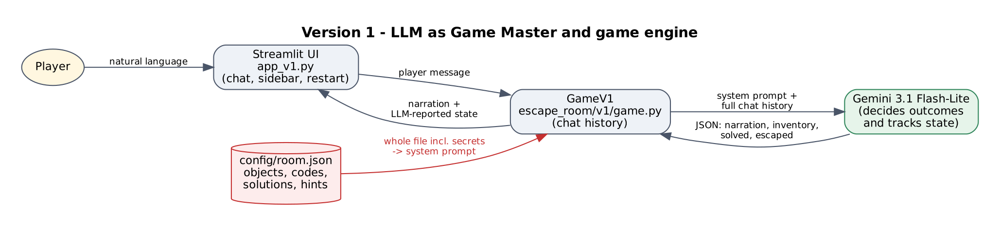
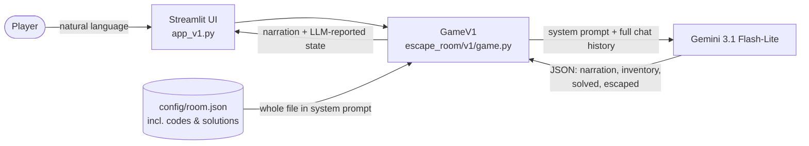
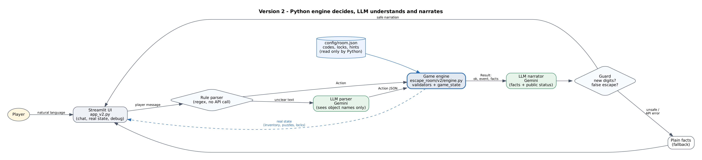
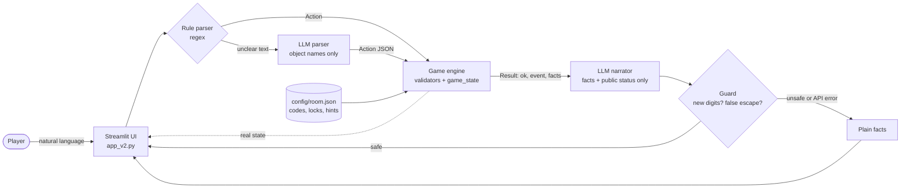

# Architecture

PNG versions of both diagrams are in [`docs/diagrams/`](diagrams/), rendered from the
Graphviz sources (`*.dot`) in the same folder:
`dot -Tpng -Gdpi=150 architecture_v2.dot -o architecture_v2.png`.

## Version 1 — LLM as Game Master and game engine

| Component | Responsibility |
|---|---|
| `app_v1.py` | Chat UI, intro, instructions, sidebar, restart, win screen |
| `escape_room/v1/game.py` | Builds the system prompt (the full room incl. secrets), keeps the chat history, calls Gemini |
| Gemini | Decides whether every action succeeds, tracks inventory/puzzles, sets `escaped` |

## Version 2 — Python engine decides, LLM only understands and narrates

| Component | Responsibility |
|---|---|
| `app_v2.py` | Chat UI; sidebar shows the engine's real state; optional debug panel |
| `escape_room/v2/parser.py` | Player text → `Action`. Regex rules first (no API call), Gemini for anything else |
| `escape_room/v2/engine.py` | `game_state` dict + validation for every action; the only code that changes state |
| `escape_room/v2/narrator.py` | Gemini describes the engine's `Result`; a guard replaces unsafe text with the plain facts |
| `escape_room/v2/game.py` | Turn loop: parse → validate → narrate; adds a hint after 4 turns without progress |

## V1 vs V2 at a glance

| Concern | V1 | V2 |
|---|---|---|
| Who decides success | LLM | `Engine` (Python) |
| Where codes live | System prompt | `config/room.json`, read only by Python |
| Inventory / solved / door | Reported by LLM | `game_state` dict |
| Invalid / adversarial input | Depends on the model | Parsed to an action the engine validates |
| API calls per turn | 1 | 1 (simple commands) or 2 |
| If Gemini is rate-limited | Turn fails | Narration falls back to plain facts |
